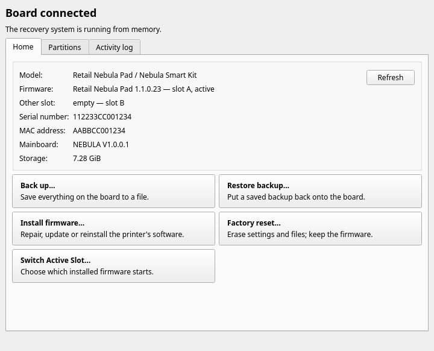

# nocry

A recovery, backup and firmware-installation tool for Ingenic X2000E-based Creality boards. It replaces Ingenic's Cloner with something safer and easier: everything it loads onto the board runs from RAM, every write is verified, and it cannot send eFuse or secure-boot commands.

**Status: early.** Most of it has been run on a retail Creality Nebula Pad (and the same board converted to Ender-3 V3 KE firmware and back). On a K1 mainboard the loader, the recovery system and a full backup work; installing K1-family firmware has so far only been tested on image copies of that board. Use it at your own risk and take a backup first.

## Boards

| Family | Printers | Firmware | State |
|---|---|---|---|
| Nebula Pad | retail Nebula Pad, Ender-3 V3 KE, CR-10 SE, Ender-5 Max | one per printer type | tested on hardware |
| K1 | K1, K1 Max, K1C (pre-2025), K1 SE, and others on mainboards `CR4CU220812S10/S11/S12` | one "K1 series" firmware for all of them; the printer type and mainboard fields of the board's identity decide the configuration | loader, recovery, backup tested on a K1 mainboard; installs tested on image copies only |
| K1 | Ender-3 V3, Ender-3 V3 Plus | "Ender-3 V3 series" firmware | not tried on hardware |

What a firmware supports (which printer types, on which mainboards) is read from the firmware itself, so nocry asks which printer a board is for only when the board and the firmware leave it open. Firmware for the other family is refused. The newer firmware generation for K1 printers with the CFS-C upgrade (`..._ota_X2000E_...img`) can be read and is labelled as such.

Storage size and partition table: an existing table is used as it is. When a board is rebuilt from scratch, the factory table is fitted to the board's storage the way Creality's factory tool does it (the last partition, `userdata`, takes whatever is left), so 4, 8 and 32 GB parts all work.

## Download

Get the latest pre-release from the [releases page](https://github.com/destinal/nocry/releases).

| Platform | Package | State |
|---|---|---|
| Linux (x86-64) | `.AppImage` | Tested: backup, firmware install from Creality's list, slot copy, secure erase. On first run the window offers to install the udev rule a normal user needs (one password prompt). |
| macOS (Apple silicon) | `.dmg`, drag to Applications | Tested: a full backup and a firmware install on a Nebula Pad both worked. No driver or setup needed. Unsigned: right-click the app and choose Open the first time. |
| Windows (x64) | `-setup.exe`, installs for the current user without administrator rights; or `-portable.zip`: unzip anywhere, run `nocry-gui.exe` | The app starts, but Windows needs a one-time USB driver setup before it can talk to the board. The window offers it ("Set up driver…", one administrator prompt); talking to a board on Windows is **not yet tested**. See "Windows driver" below. |



<sub>The serial number and MAC address in the screenshots are made up. More: [Advanced tab](docs/screenshots/advanced.png).</sub>

## What it does

- Loads its own SPL and second stage through the SoC's USB boot mode (hold BOOT, tap RESET). No blobs: both are built from GPL U-Boot source with the patches in `tools/burner-build`.
- Boots a small recovery Linux from RAM (`tools/recovery-build`) that offers a fastboot service, adb and a USB serial console. The PC never opens a disk device, so no raw-disk privileges are needed.
- **Back up** the whole eMMC to a file, verified by hashes computed on the board (about 5 minutes for 7.3 GiB).
- **Restore** a backup; only the parts that differ are written.
- **Install firmware** from a Creality `.ingenic` package or an unpacked OTA: repair in place (keep data) or clean install. Handles a completely blank board, generating a serial number and MAC address if needed.
- **Convert** within a family: between Nebula-based models (retail Nebula Pad, Ender-3 V3 KE, CR-10 SE, Ender-5 Max) by installing the other model's firmware, or which K1-family printer a K1 mainboard is set up for.
- **Switch the active firmware slot** (A/B) and **factory reset**.
- **Install to the other slot**: put a second firmware version of the same printer type beside the running one, then choose which starts. Untested on hardware beyond the write itself: no board has been started from slot B yet.
- **Copy a slot**: copy the firmware of slot A into slot B or the other way round, verified (about 40 seconds), from the Switch Active Slot window or with `nocry copy-slot a --yes`.
- **Secure erase**: a factory reset that also destroys the old settings and files, using the storage chip's secure erase where it has one (it does on the Nebula Pad), then checks that every byte is zero. About 3 minutes.
- **Board log**: read the recovery system's kernel log from the window or with `nocry boot-log`.
- **Rebuild a blank board** from an update file or the list: the bootloader and partition table that update files lack are fetched once from Creality's factory package and checksum-verified.
- **Advanced**: back up, restore or erase a single partition; edit the serial number, MAC address and model; erase the entire storage.
- **Pick firmware from a list**: versions published by Creality for the supported printers, downloaded and checksum-verified, or use a local update file (`*_ota_img_V*.img`), `.ingenic` package or folder.
- **Shell access**: the window shows whether `adb` and the USB serial console are available on the running recovery and gives the exact command for each.

## Layout

| Path | What |
|---|---|
| `host/core` | `nocry-core`, the Rust library: USB boot loader, fastboot client, image formats, GPT, `sn_mac`, backup/restore/install engines |
| `host/cli` | the `nocry` command-line tool |
| `host/ffi` | C interface to the library (`nocry.h`) |
| `gui` | Qt 6 Widgets front end |
| `tools/burner-build` | reproducible Docker build of the SPL and U-Boot stages (fastboot, USB disk) |
| `tools/recovery-build` | reproducible build of the recovery Linux (kernel patch, Buildroot config, `nocry-fbd`) |
| `tools/splhdr` | generator for the SPL parameter header (DDR settings) |
| `docs` | findings and design notes: USB boot protocol, `sn_mac`, `.ingenic` packages, restore logic, fastboot/recovery design, GUI plan |

## Building

```sh
tools/burner-build/build.sh        # SPL + stage2 images (needs Docker)
tools/recovery-build/build.sh      # recovery Linux (needs Docker; ~15 min the first time)
(cd host && cargo build --release) # the nocry CLI: host/target/release/nocry
cmake -S gui -B gui/build -DCMAKE_BUILD_TYPE=Release && cmake --build gui/build -j   # GUI (Qt 6)
```

On Linux a udev rule is needed so a normal user can open the USB devices. The window offers to install it on first run (one password prompt); by hand, copy `host/contrib/60-nocry.rules` into `/etc/udev/rules.d/`. See `host/README.md` for the command-line tool and `gui/README.md` for the GUI.

## Windows driver

Windows does not let a program talk to a USB device until a driver is assigned to it. nocry uses WinUSB, which is part of Windows, so no driver code is installed; `host/contrib/windows/nocry.inf` only names the board's USB IDs.

Windows accepts such a file only when it is signed by a publisher the computer trusts, and nocry has no bought signing certificate. So `install-driver.ps1` (run by "Set up driver…" in the window, or by hand from an administrator PowerShell) creates a certificate on your computer, signs the file once, adds the certificate to the computer's trusted lists and then destroys the certificate's private key, so nothing else can ever be signed with it. `install-driver.ps1 -Uninstall` removes the driver package and the certificate again; uninstalling nocry does not.

A GitHub Actions job (`windows-driver`) checks on a current Windows that the package is accepted, can be installed twice, and uninstalls cleanly.

## Safety

- The bootrom loader only sends requests 0x00–0x05; the stages are built without eFuse code.
- Destructive actions are dry runs or ask for confirmation first, and save the partition table, slot record and identity to the PC before writing.
- Boards with secure boot (the 2025 K1C, X2600E) are out of scope. A board whose processor is not in the X2000 family is refused before anything is sent to it. Secure boot itself cannot be queried, so an X2000 board with it enabled shows up as a loader that never starts, and nocry says so.
- Changing a board's serial number or MAC address, or copying another board's identity, is possible and is your responsibility.

## Credits and licence

Built on the work of [ballaswag/ingenic-usbboot](https://github.com/ballaswag/ingenic-usbboot), [k1-debian](https://github.com/k1-debian) (U-Boot and Linux trees for these boards) and [Ingenic-community](https://github.com/Ingenic-community). Not affiliated with Creality or Ingenic.

GPL-2.0-or-later. See `LICENSE`.
